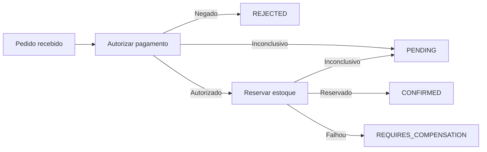

# DevOps não começa no pipeline

**Case fictício e didático — DevOpsDays Recife 2026**

Este repositório acompanha a palestra **DevOps não começa no pipeline: uma Engenheira de Software explica por quê**, de **Shirleide da Silva** (12/12/2026).

## A história

Um e-commerce autorizou o pagamento, não reservou o estoque e mesmo assim retornou um pedido **CONFIRMED**. O build, os testes existentes e o pipeline estavam verdes, mas faltava uma regra de negócio essencial.

> **CONFIRMED ⇒ pagamento AUTHORIZED e estoque RESERVED.** Esta é uma condição necessária, não garantia de atomicidade distribuída.

Sem pagamento real, clientes reais, banco de dados ou integrações externas. **Não use como implementação de produção.**

## Demo interativa no navegador (GitHub Pages)

A pasta `docs/` contém uma **demo estática** e responsiva para comparar cinco cenários de pedido com a regra antiga (bug) e a regra corrigida.

- **Código da interface:** [docs/index.html](docs/index.html)
- **Como ativar a página:** [docs/ATIVAR_GITHUB_PAGES.md](docs/ATIVAR_GITHUB_PAGES.md)
- **Endereço previsto após ativação:** https://shirleide.github.io/devops-nao-comeca-no-pipeline/
- **Evidências reais do CI:** [fase 01](https://github.com/shirleide/devops-nao-comeca-no-pipeline/actions/runs/43998063185) · [fase 03](https://github.com/shirleide/devops-nao-comeca-no-pipeline/actions/runs/43998114881) · [fase 04](https://github.com/shirleide/devops-nao-comeca-no-pipeline/actions/runs/43998122253)

> A página simula pagamento, estoque e timeline exclusivamente no navegador. Não executa a API Node.js hospedada; os links de GitHub Actions são evidências reais.

## Como executar (Node.js 22+; CI usa Node 24)

```bash
npm ci
npm run check
npm test
npm run contract
npm run flow:check
npm run build
npm run demo:fluxos
npm start
```

## API

- `GET /health` — status do servidor;
- `GET /scenarios` — cinco cenários didáticos;
- `POST /orders` — cria pedido e devolve seu estado de negócio;
- `GET /orders/{id}` — consulta o pedido;
- `GET /orders/{id}/flow` — cinco etapas da timeline;
- `GET /metrics` — contadores sem identificadores individuais.

```bash
curl -s -X POST http://localhost:3000/orders \
  -H 'Content-Type: application/json' \
  -d '{"sku":"SKU-SEM-ESTOQUE","quantity":1}'
```

## Veja a evolução no Git

| Branch | Demonstração |
| --- | --- |
| fase/00-bootstrap | Estrutura mínima do Node |
| fase/01-pipeline-verde-bug | Testes passam com bug de confirmação |
| fase/02-requisito-e-estados | Invariante e estados documentados |
| fase/03-teste-vermelho | Testes novos encontram a falha (vermelho intencional) |
| fase/04-invariante-corrigida | Corrige confirmação sem reserva de estoque |
| fase/05-contrato-api | OpenAPI e testes HTTP |
| fase/06-observabilidade | Logs e métricas de negócio |
| fase/07-ci-cd-completo | Pipeline CI e CD com publicação opt-in |
| fase/08-fluxo-ideal-e-falhas | Fluxos, estados, API de timeline e gates |
| main | Case corrigido e documentado para demonstração |

```bash
git switch fase/01-pipeline-verde-bug && npm test && npm run demo
git switch fase/03-teste-vermelho && npm test  # FALHA ESPERADA
git switch fase/04-invariante-corrigida && npm test
git switch main && npm run flow:check
```

## Diagramas



## CI/CD

- **CI:** sintaxe → testes → contrato → gate de negócio → build → artefato.
- **CD:** valida de novo; publicação GHCR requer variável Actions `PUBLISH_IMAGE=true`. Deploy externo requer também `DEPLOY_ENABLED=true` e secret `DEPLOY_HOOK_URL` no environment `production`.
- **Por padrão, nenhuma imagem é publicada nem deploy externo é disparado.** A visibilidade do pacote GHCR é independente da do repositório.

Documentação: [CI/CD](docs/CI_CD.md) · [Regra e estados](docs/REGRA_E_ESTADOS.md) · [Fluxos e erros](docs/FLUXOS_E_FALHAS.md) · [OpenAPI](docs/openapi.json) · [Guia das branches](docs/GUIA_DE_BRANCHES.md)

Projeto de uso educativo licenciado sob MIT. Contatos: **@shirleide.dev**.
